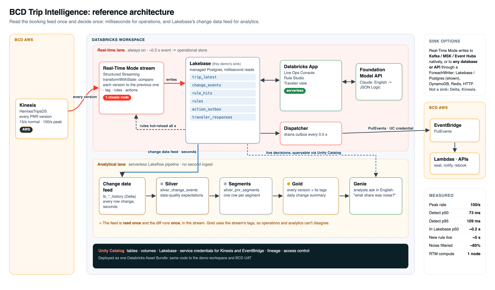

# BCD Trip Intelligence: real-time and batch booking-change detection on Databricks

BCD receives a new copy of a booking (PNR) every time any system touches it: often 10–200 versions per booking,
most of them meaningless re-saves. This repo shows BCD's change-tracking process running on Databricks:

- **Real-time lane:** every booking version is compared to the previous one in ~0.2 s (Spark Structured Streaming
  **Real-Time Mode**). It's tagged with what changed, run through business rules analysts write in plain English,
  and turned into actions (alert ops, notify the traveler, call a service, publish to AWS EventBridge).
- **Batch lane:** a serverless Lakeflow pipeline keeps every raw version (bronze), parses and checks it (silver),
  and runs the **same change-detection code** in batch (gold) for reporting and Genie.
- **A Databricks App** with three screens: Live Ops Console, Rule Studio, and a traveler notification view.

Everything deploys from one Databricks Asset Bundle. It has been validated in a Databricks demo workspace and in
**BCD's UAT workspace**, including reads from BCD's real Kinesis stream (read-only).



## Contents

- [What's in it](#whats-in-it)
- [Measured results](#measured-results)
- [Requirements](#requirements)
- [Deploy](#deploy)
- [Run and operate](#run-and-operate)
- [Develop and test](#develop-and-test)
- [Repo layout](#repo-layout)
- [Known limitations and open questions](#known-limitations-and-open-questions)
- [Documentation](#documentation)
- [Legacy: Lakeflow primer pipeline](#legacy-lakeflow-primer-pipeline)

## What's in it

| Component | What it does | Databricks product | Code |
|---|---|---|---|
| Change-detection library | Parses a PNR version, diffs it against the previous one, tags the change, detects schedule changes, evaluates JSON Logic rules, builds actions. Pure Python, shared by both lanes. | n/a | `src/trip_intel/` |
| Real-time stream | Reads each version (Kinesis, or a synthetic generator), keeps the previous version per trip in state, applies the library, writes results idempotently to the operational store. | Structured Streaming **Real-Time Mode**, `transformWithState`, classic single node | `src/rtm/` |
| Operational store | Latest trip state, every change, rule hits, rules, action outbox, traveler responses. Lakebase is the demo's choice; Real-Time Mode can also write to Kafka/MSK, or to any database or API through a ForeachWriter. | **Lakebase** (managed Postgres) | `sql/lakebase_schema.sql` |
| Dispatcher | Drains the outbox and publishes each action to AWS EventBridge (PutEvents through a UC service credential). Without a bus configured it runs in SIMULATED mode and stores the exact entry. | Serverless job | `src/dispatcher/` |
| Batch pipeline | Bronze (one table, one append flow per source: landed files and BCD's Kinesis) → silver (parsed, data-quality expectations, flattened segments) → gold (every version vs previous, daily summary). | **Lakeflow Declarative Pipeline**, serverless | `src/batch_lane/` |
| App | Live Ops Console (significant changes as they happen, booking timelines, latency KPIs), Rule Studio (English → JSON Logic with Claude, preview, approve, live in ~5 s), Traveler view (accept or rebook). | **Databricks App** (FastAPI), Foundation Model API | `src/app/` |
| Analytics on decisions | Lakebase registered in Unity Catalog, plus views, so SQL and Genie can query rule hits and actions next to gold. | Unity Catalog database catalog, Genie | `sql/uc_realtime_views.sql`, `genie/` |

Architecture diagrams (reference architecture, per-event sequence, stateful operator, batch lane, rule lifecycle,
actions, deployment, target state, data model): [`docs/architecture/`](docs/architecture/README.md).

### One pipeline or two?

The two lanes use separate compute but share the data and the logic. They only need to be separate jobs if some
consumer needs **sub-second** results. Real-Time Mode can't write Delta, so the raw copy for analytics is its own small
ingest. If every consumer is fine with seconds, one serverless micro-batch pipeline can do everything. The same job
runs either way (`--trigger realtime|processing`); see the measured comparison below and
[`docs/WHAT_WE_BUILT.md`](docs/WHAT_WE_BUILT.md#do-they-need-two-pipelines).

## Measured results

BCD UAT, one m5d.2xlarge node, Databricks Runtime 18.2, synthetic versions in BCD's JSON shape, steady-state windows
(2026-10-07):

| Run | Rate | Event → detected p50 / p95 / p99 | Event → in Lakebase p50 |
|---|---|---|---|
| Real-Time Mode | 15 versions/s (normal) | 185 / 254 / 776 ms | 284 ms |
| Same job, 1 s micro-batch | 15 versions/s | 987 / 1,436 / 1,580 ms | 1,058 ms |
| Real-Time Mode | 100 versions/s (holiday peak) | 73 / 108 / 124 ms | 171 ms |

- Spark's built-in `e2eLatencyMs` agrees with our event → in Lakebase measurement (p50 285 ms at 15/s).
- CPU: 5% average at 15/s; 14% average (p95 27%) at 100/s on the single node.
- Cost (UAT billing, list prices): the real-time node uses 1.37 DBU/h (≈ $0.21/h, ≈ $150/month 24×7) plus EC2 on the
  AWS bill. A serverless pipeline run at demo volume is ≈ 0.28 DBU (≈ $0.10).
- About 85% of versions are tagged `NO_SIGNIFICANT_CHANGE` and kept out of the live feed.

Details and method: [`docs/DEMO_RUNBOOK.md`](docs/DEMO_RUNBOOK.md#measured-in-bcd-uat-single-m5d2xlarge-dbr-182-2026-10-07).

## Requirements

### Workspace

| Need | Why | Notes |
|---|---|---|
| Unity Catalog, a catalog and schema you can create in | Volumes, pipeline tables, views | Set per target in `bundles/trip_intel/databricks.yml` |
| **Classic compute** allowed (jobs clusters) | Standalone Real-Time Mode is classic-only | Single node, dedicated access mode, no autoscaling, no Photon, on-demand (no spot) |
| **Databricks Runtime 18.2+** for the real-time job | Python Real-Time Mode before 18.2 adds latency below ~5 records/s | Pinned to `18.2.x-scala2.13` |
| Kinesis read: **enhanced fan-out (EFO)** on 18.2, or **Runtime 19** for polling | 18.2 Real-Time Mode rejects Kinesis polling (`KINESIS_POLLING_MODE_UNSUPPORTED`) | EFO registers a consumer on the stream and needs IAM permissions. Polling shares each shard's 5 reads/s with other readers |
| Task slots ≥ source partitions + shuffle partitions | Real-Time Mode schedules all stages at once | 8 cores = 4 Kinesis shards + 4 shuffle partitions, exactly. Size up if the stream has more shards |
| UC service credential for Kinesis (and EventBridge, to send for real) | Source and dispatcher auth | The UAT stream uses `kinesis_reader_cred_uat` |
| Serverless jobs and pipelines | Dispatcher, batch lane | |
| **Lakebase** instance with Postgres native login | Operational store; the stream and app use a password role | `scripts/setup_lakebase.sh` |
| Secret scope with `lakebase-password`, `lakebase-host`, `analytics-schema` | App and jobs read these | Never commit secrets |
| SQL warehouse | App freshness query, Genie | The bundle creates a 2X-Small serverless warehouse |
| Foundation Model endpoint `databricks-claude-sonnet-5-5` | Rule Studio drafting | Any chat endpoint works via `LLM_ENDPOINT` |
| Databricks Apps | The app | Workspaces that require Apps to deploy from Git: use `scripts/publish_app_repo.sh` (below) |

### Local

- Databricks CLI (tested with v1.17.0), authenticated with a profile per workspace.
- Python 3.12 with: `pytest pyspark fastapi httpx uvicorn "psycopg[binary]" psycopg-pool databricks-sdk`.
- Optional, to re-render diagrams: `mmdc` (mermaid-cli) and Playwright with Chromium.
- Optional, to record the demo video: the `record-web-demo` tooling (Playwright + Kokoro TTS) and `ffmpeg`.

## Deploy

All commands run from `bundles/trip_intel`. Targets: `e2demo` (Databricks demo workspace) and `uat` (BCD UAT,
schema `bcd_api_uat.databricks_demo`, isolated from other teams' tables).

1. **Lakebase.** Create the instance, the `trip_intel_app` password role, the secret and the schema (one-time):
   ```bash
   P=<profile> INSTANCE=<instance-name> SCOPE=<secret-scope> scripts/setup_lakebase.sh
   ```
   Then add `lakebase-host` and `analytics-schema` to the same secret scope, and set `lakebase_host`, `secret_scope`,
   `catalog` and `schema` for the target in `databricks.yml`.
2. **Bundle.**
   ```bash
   databricks bundle validate -t <target> --profile <profile>
   databricks bundle deploy   -t <target> --profile <profile>
   ```
   Development mode pauses the hourly triggers, so nothing runs until you start it.
3. **App.**
   - Workspaces that allow workspace-file apps (`e2demo`): `databricks bundle run trip_intel_app -t e2demo`.
   - Workspaces that require Git (`uat`): publish the app-only private repo, then create the app from it and add a
     Git credential **on the app** (Configure Git credential on the app page, with a read-only token). A credential
     linked to your user doesn't grant the app access.
     ```bash
     scripts/publish_app_repo.sh          # copies src/app, src/trip_intel, app.yaml, requirements.txt only
     ```
4. **Analytics on decisions (optional).** The `e2demo` target registers the Lakebase database as a UC catalog; then
   create the views in `sql/uc_realtime_views.sql` and add them to the Genie space (`genie/bcd_trip_changes.json`).

## Run and operate

| Task | Command (from `bundles/trip_intel`) |
|---|---|
| Start the real-time stream | `databricks bundle run trip_intel_rtm --no-wait -t <target>` |
| Run the batch lane once (land versions → refresh pipeline) | `databricks bundle run trip_intel_batch -t <target>` |
| Start the dispatcher | `databricks bundle run trip_intel_dispatcher --no-wait -t <target>` |
| Override stream parameters | `databricks jobs run-now --json '{"job_id": <id>, "python_params": [...]}'` |

Real-time job flags (`src/rtm/job.py`):

| Flag | Default | Use |
|---|---|---|
| `--source rate\|kinesis` | `rate` | Synthetic generator or a Kinesis stream |
| `--rows-per-second` | 15 | Generator rate (100 = holiday peak) |
| `--seq-offset` | 0 | Start the generator at a multiple of 600 beyond earlier runs. Reusing an offset writes nothing, because idempotent writes skip trips already seen |
| `--trigger realtime\|processing` | `realtime` | Real-Time Mode, or a 1 s micro-batch on the same code |
| `--pg-schema` | `public` | Write to another Postgres schema (side-by-side comparisons, load tests) |
| `--kinesis-stream`, `--kinesis-region`, `--kinesis-credential` | UAT values | Kinesis source settings |
| `--kinesis-initial-position latest\|trim_horizon` | `latest` | Where a new checkpoint starts reading |
| `--checkpoint` | from bundle | New checkpoint path for a fresh start |
| `--debug-metrics` | off | Log full streaming progress once per batch |

Each real-time batch (default 5 minutes) logs a `RTM_LATENCY` line with Spark's built-in e2e, source-queuing and
processing percentiles. Driver logs are delivered to the checkpoint volume under `cluster_logs/`.

Reset and demo-day steps (T-60 checklist, disabling rehearsal rules, stopping everything afterwards):
[`docs/DEMO_RUNBOOK.md`](docs/DEMO_RUNBOOK.md).

## Develop and test

```bash
python -m venv .venv && .venv/bin/pip install pytest pyspark fastapi httpx uvicorn "psycopg[binary]" psycopg-pool databricks-sdk
.venv/bin/python -m pytest -q          # 86 tests, no cluster or database needed
```

Run the app locally against a target's Lakebase: set `LAKEBASE_HOST`, `LAKEBASE_PASSWORD`, `WAREHOUSE_ID`,
`ANALYTICS_SCHEMA`, `LLM_ENDPOINT` and `DATABRICKS_CONFIG_PROFILE`, then from `src/`:
`python -m uvicorn app.main:app --port 8765`.

Re-render the diagrams after editing `docs/architecture/src/`:
`PLAYWRIGHT_PY=<python with playwright> scripts/render_diagrams.sh`.

## Repo layout

```
bundles/trip_intel/databricks.yml   # the bundle: targets e2demo + uat, jobs, pipeline, warehouse, app, volumes
src/
  trip_intel/                       # shared change-detection library (payload, diff, schedule changes, rules, outbox)
  rtm/                              # Real-Time Mode job: processor, Lakebase sink, latency logging
  batch_lane/                       # landing job + Lakeflow pipeline (bronze/silver/gold)
  dispatcher/                       # outbox → EventBridge
  app/                              # Databricks App (FastAPI + static UI)
  app.yaml, requirements.txt        # app config (all settings via secrets/resources)
sql/                                # Lakebase schema + seed rules; UC views over Lakebase
genie/                              # Genie space definition
scripts/                            # Lakebase setup, SQL runner, app repo publish, diagram rendering
docs/                               # guide, runbook, architecture diagrams, video script, design spec + plan
tests/                              # unit tests
databricks.yml, resources/, src/scheduled_changes_etl/, src/generate_data/   # legacy primer (below)
```

## Known limitations and open questions

- **Schedule-change definition.** We pair a cancelled segment (HX/UN) with a new confirmed one (HK/KK/TK) on the same
  route and day, within 60 minutes. BCD's UAT test records instead flip the status on the *same* segment and move its
  time, which we tag `SEGMENT_MODIFIED`. Confirm with BCD how real data represents a schedule change.
- **Kinesis in production:** EFO (needs BCD's IAM changes) or Runtime 19 polling (shares read limits with other
  consumers). Check the shard count against task slots.
- **State never expires.** Trips stay in stream state indefinitely. Add a state TTL before running for months.
- **Generated data is simpler than real PNRs.** The parser handles BCD's UAT records, but real payloads are richer.
- **EventBridge is simulated** in the demo workspaces (no bus). With a bus and IAM role, the dispatcher sends for real.
- **Not built:** per-consumer rule sets or subscriptions, a synchronous API/Lambda call, consuming *from* EventBridge.
- **Roadmap item:** a native Lakebase/Postgres sink for Real-Time Mode would replace the custom ForeachWriter.

## Documentation

| Doc | For |
|---|---|
| [`docs/WHAT_WE_BUILT.md`](docs/WHAT_WE_BUILT.md) | Plain-language guide, glossary, one-vs-two pipelines, sink options, coverage against the 2026-10-01 call |
| [`docs/DEMO_RUNBOOK.md`](docs/DEMO_RUNBOOK.md) | Demo-day commands, arc, measurements, cost, questions for BCD, reset |
| [`docs/architecture/`](docs/architecture/README.md) | Nine architecture diagrams with explanations |
| `docs/video/demo.json` | Script for the narrated demo video (the rendered MP4 isn't committed) |
| `docs/superpowers/specs/`, `docs/superpowers/plans/` | Original design spec and implementation plan |
| [`docs/DEMO_CHEATSHEET.md`](docs/DEMO_CHEATSHEET.md) | Legacy: talk track for the earlier Lakeflow primer |

## Legacy: Lakeflow primer pipeline

The root `databricks.yml`, `resources/`, `src/scheduled_changes_etl/` and `src/generate_data/` are the earlier
Lakeflow Declarative Pipelines primer. It ran BCD's original PySpark scheduled-change notebook as a serverless
pipeline (bronze → silver → gold, in SQL and in Python with identical output), and fixed a filter bug in that notebook:
Python `or` on Column objects silently dropped `UN`/`KK`/`TK`, fixed with `.isin(...)`. It deploys separately:
```bash
databricks bundle deploy -p <profile>        # from the repo root
databricks bundle run scheduled_changes_job -p <profile>
```
