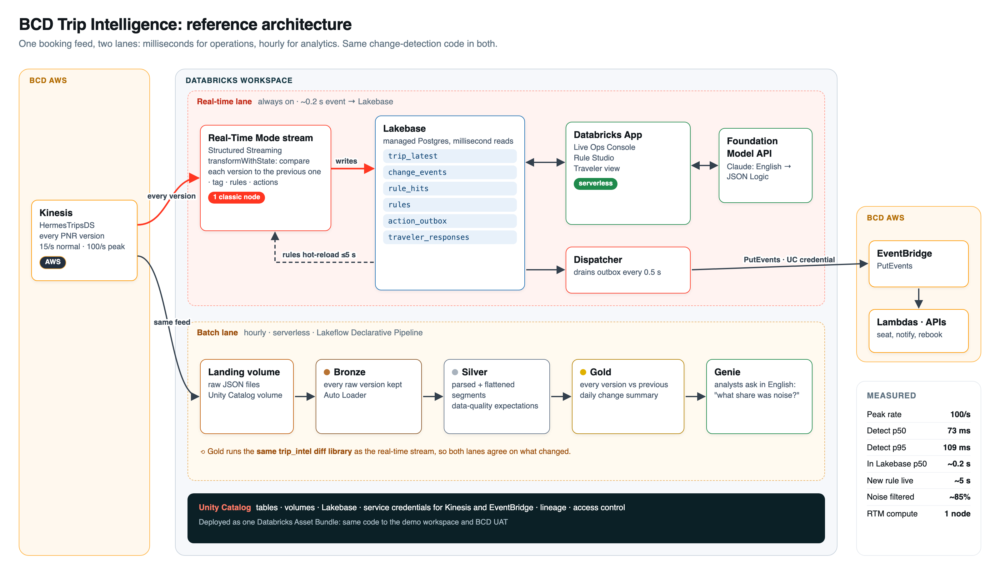
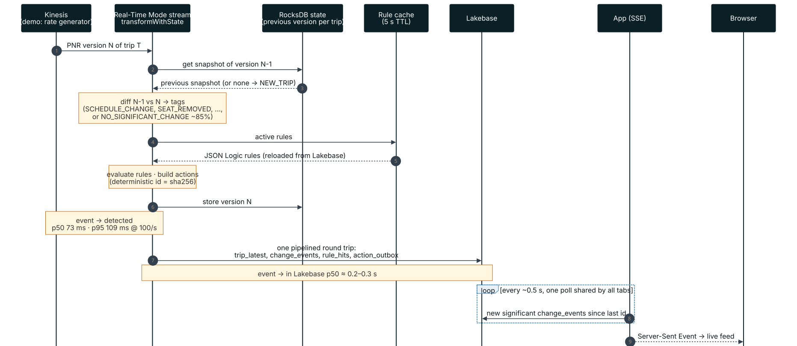
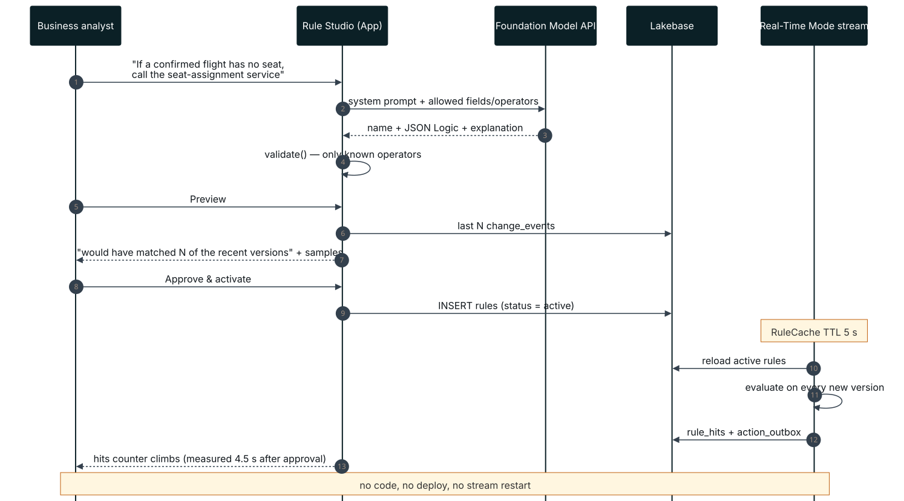
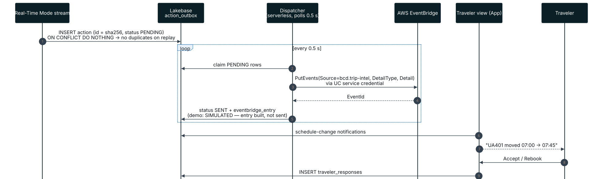
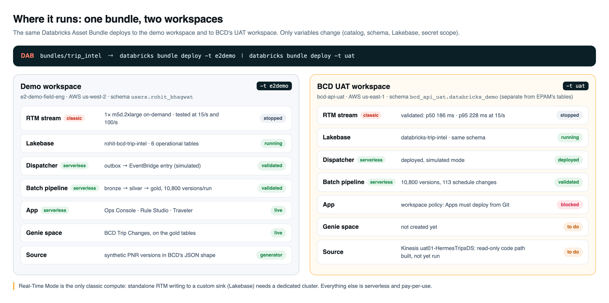

# Architecture diagrams

Sources are in `src/` (Mermaid `.mmd`, or fixed-size `.html` for the two hand-laid-out views). To re-render:
`PLAYWRIGHT_PY=<python with playwright> scripts/render_diagrams.sh`. That writes `svg/` for docs and 2× `png/` for slides.

| # | Diagram | Use it to answer |
|---|---|---|
| 1 | [Reference architecture](#1-reference-architecture) | "What did you build, end to end?" |
| 2 | [One booking version, event → screen](#2-one-booking-version-event--screen) | "Where do the 200 ms go?" |
| 3 | [Inside the stateful step](#3-inside-the-stateful-step) | "How does this replace our Lambda track-changes service?" |
| 4 | [Batch lane](#4-batch-lane-bronze--silver--gold) | "Is there a pipeline I can see? What about data quality?" |
| 5 | [Rule lifecycle](#5-rule-lifecycle-english--live-in-5-seconds) | "Can business analysts write rules?" |
| 6 | [Actions to AWS](#6-actions-to-aws-outbox--eventbridge) | "Can it publish to EventBridge? What about duplicates?" |
| 7 | [Where it runs](#7-where-it-runs) | "Is this in our environment?" |
| 8 | [Target state for BCD](#8-target-state-ingest-once-many-consumers) | "How would we run this in production next to EPAM's work?" |
| 9 | [Lakebase data model](#9-lakebase-data-model) | "What lands in the operational database?" |

## 1. Reference architecture

One Kinesis feed feeds two lanes. The **real-time lane** is a Spark Structured Streaming job in Real-Time Mode on a
single classic node. It compares each booking version to the previous one, tags what changed, evaluates rules and
writes results to Lakebase in about 0.2 s. The app, the dispatcher (outbox → EventBridge) and analysts' rules all
work against Lakebase. The **batch lane** is a serverless Lakeflow pipeline (bronze → silver → gold) that runs hourly
and serves Genie. Gold calls the same `trip_intel` diff library as the stream.

## 2. One booking version, event → screen

Measured on one m5d.2xlarge: event → detected p50 73 ms and p95 109 ms at 100 versions/s; event → in Lakebase
p50 about 0.2–0.3 s. All of a version's writes go to Lakebase in one pipelined round trip.

## 3. Inside the stateful step

`transformWithState` keeps the last snapshot of every trip in RocksDB, so every version is compared to the one
right before it. None are skipped, unlike a latest-only MERGE. Bad records are logged and skipped. Duplicate
or out-of-order versions are tagged stale. Every write is idempotent, so a restart replays safely.

## 4. Batch lane: bronze → silver → gold

## 5. Rule lifecycle: English → live in ~5 seconds

## 6. Actions to AWS: outbox → EventBridge

Each action's id is a hash of (trip, version, rule), so retries and replays never create a second action. In the demo
workspace the dispatcher runs in SIMULATED mode: it builds and stores the exact PutEvents entry but does not send it.

## 7. Where it runs

## 8. Target state: ingest once, many consumers

Real-Time Mode reads the source directly (it can't read Delta), and a streaming table lands every raw version in
bronze once. Batch consumers (finance, profiles, EPAM's pipelines, Genie) read bronze instead of each re-reading
Kinesis.

## 9. Lakebase data model

